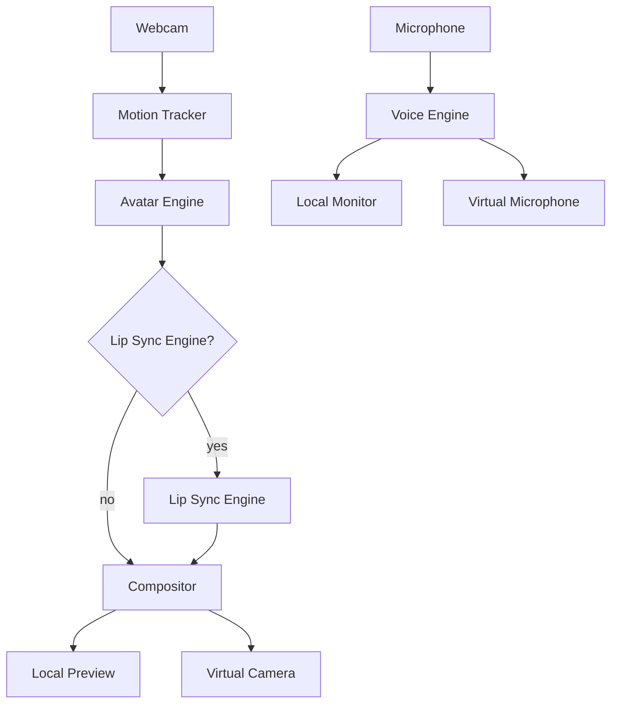

# Architecture

Moonlight Studio is a Flutter desktop app (Windows-first) with a modular
Python AI backend, built around one non-negotiable rule:

> **No AI model is a hard dependency of the application architecture.**

## Layers

```
lib/
├── app/            # theme, bootstrap (engine registration), root widget
├── core/           # errors, logging, lifecycle, performance, DI
├── domain/         # models, interfaces, pipeline, services — pure Dart,
│                   # no dart:io, no Flutter widgets, no engine-specific code
├── infrastructure/ # camera, audio, virtual devices, IPC, process mgmt
├── engines/        # concrete engine adapters (mock/simple/liveportrait/...)
└── features/       # UI screens (studio, avatars, audio, settings, diagnostics)
```

`domain/` only knows about interfaces (`AvatarEngine`, `LipSyncEngine`,
`VoiceEngine`, `MotionTracker`, `VirtualCameraProvider`,
`VirtualMicrophoneProvider`) and engine-independent models (`VideoFrame`,
`AudioFrame`, `MotionData`, `Avatar`). `engines/` implements those
interfaces. Nothing outside `engines/<category>/<name>/` may reference a
concrete engine class or check `if (id == 'liveportrait')`.

## Frame pipeline (video)

```
Camera Capture → Motion Tracking → Avatar Engine → [Lip Sync Engine]
    → Compositor (burns in watermark) → Local Preview
                                       → Virtual Camera
```

The Compositor stage is currently disabled in `StudioSession` while the
raw pipeline's performance is being tuned — see that class's doc comment
and `Compositor`'s own. Local Preview and Virtual Camera currently
receive the raw frame straight from the Avatar/Lip Sync stage. Video
reaches OBS via Window Capture of this app's own window, not by pushing
pixels into a virtual-camera bridge — see docs/virtual-devices.md.

Bounded queues only. If processing falls behind capture, **drop old
frames** — never let latency grow unbounded. `CapturePipeline` implements
this today (drop-if-busy on the video path); see `StudioSession` and
`core/performance/performance_manager.dart`.

## Audio pipeline

```
Microphone → Audio Capture → Ring Buffer → Voice Engine
    → Local Monitoring
    → Virtual Microphone
```

Audio is never blocked by video processing.

## Engine swap sequence

```
Stop old engine → Release resources → Initialize new engine → Reconnect pipeline
```

Engines are initialized fresh on every Start and torn down on every Stop
(see `StudioSession.start`/`stop`) — changing a setting in the Effects
panel and pressing Start again always picks it up. There's no separate
"swap engine mid-run" path; stopping and restarting is simple, correct,
and fast enough that it doesn't need one.

## Python workers

Heavy/GPU-bound engines (LivePortrait, MuseTalk, Wav2Lip) run as separate
Python processes, managed by `WorkerManager` and spoken to over a
localhost-only WebSocket (`WorkerIpcClient`), using the JSON envelope in
`python/common/protocol/messages.py`. Workers never import anything
Flutter-related and never open a socket beyond `127.0.0.1`.

## Model management

`models/` holds downloaded weights, one subdirectory per engine
(`models/liveportrait/`, `models/musetalk/`, ...). The app does not
auto-download large weights — see `models/README.md`. A `ModelManager`
(planned; see docs/engines.md) will report install status per engine in
the Diagnostics screen.


